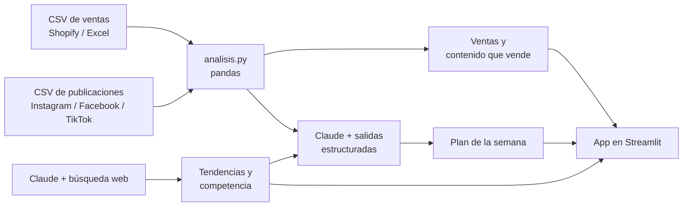

# Estratega MYPE

**El analista de marketing que una MYPE no puede contratar: cruza tus ventas, tu contenido y las tendencias de redes para decirte qué vender, qué promocionar y qué publicar la próxima semana.**

## 1. Fundadora

Jhanela Luz Carhuaz Fuster. Trabajo con datos para la toma de decisiones en el sector público (por ejemplo, decidir en qué zonas empadronar usando toda la información pública disponible). Estratega MYPE lleva esa misma idea a los negocios pequeños.

## 2. El problema

Las empresas grandes contratan analistas de datos y agencias de marketing. Las MYPES no: deciden qué traer, qué promocionar y qué publicar a ojo.

En la [entrevista 1](docs/research/entrevista-01.md), el dueño de una tienda de streetwear con 11 años en el negocio contó que vende por seis canales (tienda, web, WhatsApp, Instagram, Facebook y lives) y junta todo en Excel. Lo que más le duele: **"qué tipo de contenido hacer, cuál video vende más"**. Como todos pueden importar los mismos productos, el contenido es lo único que lo diferencia, y no sabe cuál funciona.

Las notas de las conversaciones con usuarios están en [`docs/research/`](docs/research/).

## 3. La solución y el insight

Estratega MYPE conecta cada publicación con las ventas que vinieron después:

1. **Ventas:** qué se vende más, por qué canal y qué día.
2. **Contenido que vende:** para cada post, cuántas unidades extra vendió ese producto en los 4 días siguientes. Así se ve qué formato (reel, live, carrusel, foto) y qué red traen ventas de verdad, no solo likes.
3. **Tendencias y competencia:** Claude busca en internet qué se mueve en redes para el rubro en el Perú y qué tiendas online compiten, con fuentes.
4. **Plan de la semana:** Claude junta todo y propone qué productos impulsar, qué promociones hacer (por ejemplo, liquidar temporadas pasadas) y un calendario de 5 publicaciones.

**Insight:** las MYPES miden su contenido en likes, pero los likes no pagan. Lo que importa es qué post vino antes de una venta, y esos datos ya existen (Shopify y las redes), solo que nadie los cruza.

Además, la app **avisa cuando faltan datos**: con menos de 4 semanas de ventas o pocas publicaciones no da recomendaciones, para no inventar patrones.

## 4. Por qué ahora

- Hace dos años, un modelo de IA no podía buscar en internet, leer tendencias y devolver un plan ordenado por poco dinero. Hoy sí.
- Las MYPES peruanas ya venden por redes (Instagram, Facebook, WhatsApp, TikTok), así que ya generan los datos que hacen falta.
- Las apps que existen (como Treinta) registran ventas, pero no dicen qué hacer. Los bots de WhatsApp responden a clientes, pero no analizan. Nadie conecta el contenido con las ventas para una MYPE.

## 5. Demo

**Demo en vivo:** _(pendiente: URL de Streamlit Community Cloud)_

Mientras tanto, corre en local:

```bash
uv sync
cp .env.example .env    # y pega tu clave de API de Anthropic
uv run streamlit run app.py
```

Para regenerar los datos de ejemplo:

```bash
uv run python scripts/generar_datos.py
```

**Datos:** la demo usa datos sintéticos (inventados) de una tienda de streetwear, armados a partir de la entrevista: 1,141 ventas y 54 publicaciones entre agosto y octubre de 2026. No hay datos personales de nadie. Puedes subir tus propios CSV con las mismas columnas.

**Capturas:** _(pendiente: 3 capturas de la app)_

**Arquitectura:**



**Modelos y APIs:** Claude Opus 5.5 (`claude-opus-5-5`) por la API de Anthropic, con la herramienta de búsqueda web y salidas estructuradas. Si el modelo rechaza una consulta, la API la reintenta sola con un modelo de respaldo (server-side fallback).

## 6. Modelo de negocio

- **Quién paga:** el dueño de la MYPE que ya vende por redes y quiere crecer (no la bodega más pequeña).
- **Precio:** S/ 49 al mes por tienda. Referencia: estas MYPES ya pagan cursos de "cómo vender por internet".
- **Costo por usuario:** cada tienda usaría unas 4 búsquedas de tendencias y 4 planes al mes. Claude Opus 5.5 cuesta $4 por millón de tokens de entrada y $20 por millón de salida, más la búsqueda web. El servidor (Streamlit Community Cloud) es gratis para empezar. _(pendiente: medir el costo real con los tokens de una corrida)_
- **Siguiente paso de negocio:** probar el precio con las tiendas entrevistadas.

## 7. Herramientas del curso que usa

| Herramienta | Dónde está |
|---|---|
| Modelos de IA por API: Claude con búsqueda web (investiga tendencias y competencia) | [`ia.py`](ia.py), función `buscar_tendencias` |
| Modelos de IA: salidas estructuradas (el plan sale en un formato fijo) | [`ia.py`](ia.py), función `armar_plan` |
| Visualización y dashboard en Streamlit | [`app.py`](app.py) |
| Análisis de datos con pandas | [`analisis.py`](analisis.py) |

## 8. Qué generó Claude Code

Claude Code escribió la primera versión de los cuatro archivos de código (`app.py`, `analisis.py`, `ia.py` y `scripts/generar_datos.py`) a partir de mis instrucciones y de la entrevista. Yo definí el problema, el usuario, la regla de "avisar cuando faltan datos", las métricas y el enfoque en contenido. También ordenó mis notas de la entrevista. Revisé el código y puedo explicar cada parte.

## 9. Roadmap

- Leer directamente el export de pedidos de Shopify y las estadísticas de Meta (Instagram, Facebook, WhatsApp Business).
- Leer la foto del cuaderno de ventas, para MYPES que todavía anotan en papel.
- Análisis de competencia con la Biblioteca de Anuncios de Meta.
- Mapa de la zona (competidores cerca y nivel de ingreso por manzana del INEI) para negocios con local.

## Licencia

MIT. Ver [LICENSE](LICENSE).
