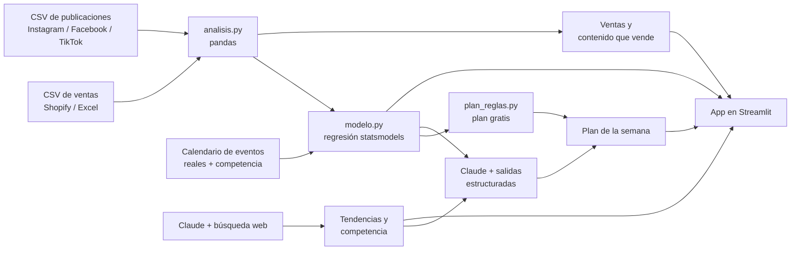

# Estratega MYPE

**El analista de marketing que una MYPE no puede contratar: cruza tus ventas, tu contenido y las tendencias de redes para decirte qué vender, qué promocionar y qué publicar la próxima semana.**

## 1. Fundadora

Jhanela Luz Carhuaz Fuster. Trabajo con datos para la toma de decisiones en el sector público (por ejemplo, decidir en qué zonas empadronar usando toda la información pública disponible). Estratega MYPE lleva esa misma idea a los negocios pequeños.

## 2. El problema

Las empresas grandes contratan analistas de datos y agencias de marketing. Las MYPES no: deciden qué traer, qué promocionar y qué publicar a ojo.

En la [entrevista 1](docs/research/entrevista-01.md), el dueño de una tienda de streetwear con 11 años en el negocio contó que vende por seis canales (tienda, web, WhatsApp, Instagram, Facebook y lives) y junta todo en Excel. Lo que más le duele: **"qué tipo de contenido hacer, cuál video vende más"**. Como todos pueden importar los mismos productos, el contenido es lo único que lo diferencia, y no sabe cuál funciona.

En la [entrevista 2](docs/research/entrevista-02.md), la dueña de un consultorio dental (también con 11 años) contó lo mismo desde otro rubro: lo que más le quita tiempo es **captar pacientes** y lograr que el primer contacto por WhatsApp termine en una cita. Ya paga **dos agencias de marketing** y un servicio que le informa qué hace la competencia.

Dos rubros distintos, el mismo dolor: no saben qué contenido o qué mensaje les trae clientes. Y los dos **ya pagan** por ayuda (cursos, agencias, software).

Las notas de las conversaciones con usuarios están en [`docs/research/`](docs/research/).

## 3. La solución y el insight

Estratega MYPE conecta cada publicación con las ventas que vinieron después:

1. **Ventas:** qué se vende más, por qué canal y cómo evolucionan semana a semana.
2. **Contenido que vende:** para cada post, cuántas unidades extra vendió ese producto en los 4 días siguientes. Así se ve qué formato (reel, live, carrusel, foto) y qué red traen ventas de verdad, no solo likes.
3. **Qué mueve tus ventas (modelo estadístico):** una regresión explica las ventas diarias de cada producto con todo a la vez: el contenido, el día de la semana, la quincena, los descuentos, las promociones de la competencia y un **calendario de eventos externos reales** (feriados, Cyber Wow, Black Friday, elecciones 2026, paros, crisis política, El Niño costero). Así separa efectos: "¿se vendió más por el reel o porque era quincena?".
4. **Tu cliente objetivo:** con datos reales del INEI. La **ENAHO 2025** muestra quién gasta más en ropa (en Lima, los hogares con hombres de 18 a 34 años gastan S/ 70 al mes, 28% más que los demás), y el **Censo 2025** muestra en qué distritos viven (San Juan de Lurigancho, San Martín de Porres, Ate, Comas...).
5. **Tendencias y competencia:** Claude busca en internet qué se mueve en redes para el rubro en el Perú y qué tiendas online compiten, con fuentes. Sin clave de API, la app muestra un ejemplo guardado, marcado como tal.
6. **Plan de la semana:** qué productos impulsar, qué promociones hacer (por ejemplo, liquidar temporadas pasadas o preparar Black Friday) y un calendario de 5 publicaciones. Tiene dos versiones: **con reglas** (gratis, sale de los resultados del modelo) y **con Claude** (más fina, necesita clave de API).

**Insight:** las MYPES miden su contenido en likes, pero los likes no pagan. Lo que importa es qué post vino antes de una venta, y esos datos ya existen (Shopify y las redes), solo que nadie los cruza.

Además, la app **avisa cuando faltan datos**: con menos de 6 meses de ventas o pocas publicaciones no corre el modelo ni da recomendaciones, para no inventar patrones.

**El calendario de eventos es el activo que crece:** se arma una sola vez y sirve para todos los clientes, porque las elecciones o El Niño afectan igual a una tienda de ropa que a un consultorio dental. Cada cliente nuevo cuesta casi nada, y mientras más años de eventos se acumulen, más difícil es copiarlo.

## 4. Por qué ahora

- Hace dos años, un modelo de IA no podía buscar en internet, leer tendencias y devolver un plan ordenado por poco dinero. Hoy sí.
- Las MYPES peruanas ya venden por redes (Instagram, Facebook, WhatsApp, TikTok), así que ya generan los datos que hacen falta.
- Las apps que existen (como Treinta) registran ventas, pero no dicen qué hacer. Los bots de WhatsApp responden a clientes, pero no analizan. Nadie conecta el contenido con las ventas para una MYPE.

## 5. Demo

**Demo en vivo:** https://estratega-mype.streamlit.app/

La primera vez que se abre puede tardar un minuto en despertar. Para correrla en local:

```bash
uv sync
cp .env.example .env    # y pega tu clave de API de Anthropic
uv run streamlit run app.py
```

Para regenerar los datos de ejemplo:

```bash
uv run python scripts/generar_datos.py
```

**Datos:**

| Archivo | Qué es | ¿Real o inventado? |
|---|---|---|
| `datos/ventas_ejemplo.csv` | 8,191 ventas de una tienda de streetwear, nov. 2024 a nov. 2026 | Inventado, a partir de la entrevista 1 |
| `datos/publicaciones_ejemplo.csv` | 400 publicaciones en redes | Inventado |
| `datos/competencia_ejemplo.csv` | Días en que un competidor lanzó promoción | Inventado |
| `datos/calendario_eventos.csv` | Feriados, Cyber Wow, Black Friday, elecciones 2026, paros, vacancia presidencial, El Niño costero | **Real**, cada evento con su fuente |
| `datos/ejemplo_tendencias.md` | Tendencias y competencia online | **Real**, búsqueda web con Claude del 11/11/2026, con fuentes |
| `datos/enaho_vestido_2025.csv` | Gasto mensual en vestido y calzado por nivel socioeconómico, tipo de hogar y región | **Real**: INEI, ENAHO 2025, ponderado. Se arma con `scripts/preparar_enaho.py` |
| `datos/censo2025_lima_callao.csv` | Población y hombres y mujeres de 18 a 34 años en los 50 distritos de Lima y Callao | **Real**: INEI, Censo 2025 (REDATAM). Se arma con `scripts/preparar_censo2025.py` |

**Servidor MCP del Censo 2025:** el INEI no tiene API del censo. [`mcp/censo2025.py`](mcp/censo2025.py) manda programas REDATAM al «Procesador Estadístico En-línea» del INEI y devuelve la tabla, para que Claude Code pueda consultar el censo con dos herramientas (`variables_censo2025` y `consultar_censo2025`). Está adaptado del servidor del Censo 2017 de mi proyecto `agente-datos-peru`. Se conecta solo con `.mcp.json`; para usarlo a mano: `uv run --group mcp mcp/censo2025.py`. Ojo: en esta base del censo, Lima Metropolitana tiene código 27, no 15.

Las ventas inventadas esconden patrones a propósito (los lives y reels venden más, la quincena sube las ventas, los paros las bajan), y el modelo los encuentra por su cuenta. No hay datos personales de nadie. Puedes subir tus propios CSV con las mismas columnas.

**Capturas:** _(pendiente: 3 capturas de la app)_

**Arquitectura:**



**Modelos y APIs:** Claude Opus 5.5 (`claude-opus-5-5`) por la API de Anthropic, con la herramienta de búsqueda web y salidas estructuradas. Si el modelo rechaza una consulta, la API la reintenta sola con un modelo de respaldo (server-side fallback).

## 6. Modelo de negocio

- **Quién paga:** el dueño de la MYPE que ya vende por redes y quiere crecer (no la bodega más pequeña).
- **Precio:** S/ 49 al mes por tienda. Referencia: estas MYPES ya pagan cursos de "cómo vender por internet".
- **Costo por usuario:** cada tienda usaría unas 4 búsquedas de tendencias y 4 planes al mes. Claude Opus 5.5 cuesta $4 por millón de tokens de entrada y $20 por millón de salida, más la búsqueda web. El servidor (Streamlit Community Cloud) es gratis para empezar. _(pendiente: medir el costo real con los tokens de una corrida)_
- **Siguiente paso de negocio:** probar el precio con las tiendas entrevistadas.

## 7. Herramientas del curso que usa

| Herramienta | Dónde está |
|---|---|
| Modelos de IA por API: Claude con búsqueda web (investiga tendencias y competencia) | [`ia.py`](ia.py), función `buscar_tendencias` |
| Modelos de IA: salidas estructuradas (el plan sale en un formato fijo) | [`ia.py`](ia.py), función `armar_plan` |
| Visualización y dashboard en Streamlit (sesión 05) | [`app.py`](app.py) |
| Modelo estadístico: regresión con statsmodels | [`modelo.py`](modelo.py) |
| Servidor MCP propio para el Censo 2025 en REDATAM (sesión 04) | [`mcp/censo2025.py`](mcp/censo2025.py) |
| Microdatos del INEI: ENAHO 2025 ponderada | [`scripts/preparar_enaho.py`](scripts/preparar_enaho.py) |
| Análisis de datos con pandas | [`analisis.py`](analisis.py) |

## 8. Qué generó Claude Code

Claude Code escribió la primera versión del código (`app.py`, `analisis.py`, `modelo.py`, `plan_reglas.py`, `ia.py` y `scripts/generar_datos.py`) a partir de mis instrucciones y de las entrevistas. También adaptó al Censo 2025 mi servidor MCP de REDATAM del Censo 2017 (`mcp/censo2025.py`), escribió los scripts que resumen la ENAHO 2025 y el censo, buscó en internet las fechas reales del calendario de eventos y el ejemplo guardado de tendencias y competencia (`datos/ejemplo_tendencias.md`), y ordenó mis notas de las entrevistas.

Yo definí el problema, el usuario, el enfoque en contenido, la regla de "avisar cuando faltan datos", la idea de usar un modelo estadístico con la competencia y los eventos externos (elecciones, El Niño, crisis política) como variables, y que el calendario de eventos sirva para todos los clientes. Revisé el código y puedo explicar cada parte.

## 9. Roadmap

- Leer directamente el export de pedidos de Shopify y las estadísticas de Meta (Instagram, Facebook, WhatsApp Business).
- Leer la foto del cuaderno de ventas, para MYPES que todavía anotan en papel.
- Análisis de competencia con la Biblioteca de Anuncios de Meta.
- Mapa de la zona (competidores cerca y nivel de ingreso por manzana del INEI) para negocios con local, como el consultorio dental.
- Actualizar el calendario de eventos de forma automática (BCRP, JNE, ENFEN, Defensoría del Pueblo) y sumar variables como el tipo de cambio.
- Plan del mes para decidir compras e importaciones.
- Para consultorios: medir qué respuestas de WhatsApp terminan en una cita. Nunca tocar historias clínicas ni otros datos de salud.

## Licencia

MIT. Ver [LICENSE](LICENSE).
